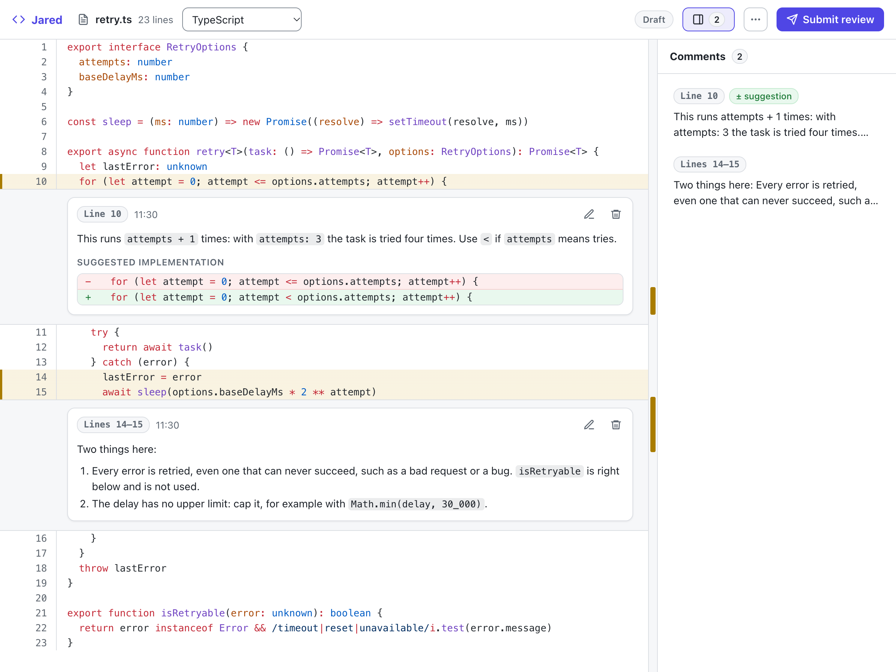
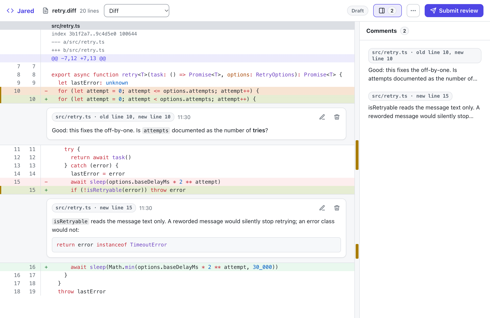

# Jared for Claude Code

Jared /ˈdʒær.əd/ is not Gerrit /ˈɡɛr.ɪt/.

Syntax-highlighted, file-based review for Claude.

A Claude Code plugin. It opens a source file, several files, a diff or a commit in Jared, a line-by-line review app, and brings your review back into the session.

## What it looks like

A file in Jared, with two comments. The first has a suggested change.

<picture>
  <source media="(prefers-color-scheme: dark)" srcset="screenshots/review-dark.png">
  
</picture>

A diff is shown as changes. A comment on it says which file it is about, and which lines of the old and the new version. A diff of several files has a list of its files beside the code, where you can mark each file as viewed.

<picture>
  <source media="(prefers-color-scheme: dark)" srcset="screenshots/diff-dark.png">
  
</picture>

## Requirements

- Claude Code
- a browser
- `sh` and `perl` (macOS and Linux have both)
- a command that reads the clipboard: `pbpaste` on macOS, `wl-paste` or `xclip` on Linux

## Install

In a terminal, add the marketplace from GitHub, then install the plugin:

```bash
claude plugin marketplace add snofla/claude-jared
claude plugin install jared@claude-jared
```

## Use

In a Claude Code session, give the plugin a source file, a diff or a commit:

```
/jared:review path/to/file.ts
/jared:review 74664abd
```

A commit is opened as its change, with its message above it; the plugin looks it up in the git repository of the folder your session is in.

To review several files together, give a wildcard, a list separated by spaces or commas, or both: `/jared:review src/lib/*.ts`, or `/jared:review a.ts, b.ts`. Put a path with a space in quotes. Claude finds the files and tells you how many it found, and asks before it opens more than 20. It leaves out a file that is empty, is not text, or is more than 512 KB, and says so.

Jared opens at most 100 files, and 512 KB in all. When the files are together more than that, Claude says the total and offers the first files that fit. Several files open only in your session's browser: if your session has none, or you gave `--jared` or set `jared_url`, Claude says so and stops.

You can also pick several files on the start page, or drop several files or a folder on it. They open in one scroll, with a list of the files beside the code (the **Files** button), where you can mark each file as **Viewed**.

You can also ask in words: "review `path/to/file.ts` in Jared" or "review commit `74664abd` in Jared".

To see which version of the plugin you have, run `/jared:version`.

Jared opens with your file, in your session's browser if it has one (the browser pane of the Claude app, or Claude in Chrome), and otherwise in your own browser. Write your comments there. How the review comes back depends on which of the two it is.

### In your session's browser

Press **Submit review**. The review goes to the session. If the session has not answered in a minute, tell it that you pressed the button.

Claude waits for the review for up to ten minutes. If the time runs out, Claude Code may show the wait as a command that "failed with exit code 3". That is the end of the wait and not a failure: press the button when you are ready, and tell the session.

Your session's browser gets Jared from a small service on your computer. It stops by itself after half an hour without use. Jared opens at the same place in your browser each time, so your saved reviews are normally still under **Continue reviewing** after it has stopped. To see whether it is running, and when it ends, run `/jared:status`. To stop it sooner, run `/jared:stop`.

### In your own browser

Jared opens from a single file on your computer. It needs no server and no Node.

Press **Export review**, then choose one of two ways:

- **Copy** puts the review on the clipboard. Tell the session that it is there.
- **Download** saves the review as `file.ts.review.json` in your downloads folder. Give the session the path of that file and the path of the source file:

  ```
  /jared:review path/to/file.ts.review.json path/to/file.ts
  ```

### Options

All of these are optional. Add them after the file, the diff or the commit.

| Option | What it does |
|---|---|
| `--rev <commit>` | Reads the word you gave as a commit, even if a file has that name. |
| `--jared <address>` | Uses the Jared that runs at that address, for this review. The plugin setting `jared_url` does the same for every review. Use it only for a Jared that you run yourself or trust. |
| `--via <way>` | Chooses how the file gets to Jared and how the review comes back. The default, `auto`, takes the first way in the next table that fits. Name a way, and only that way is tried. |
| `--block` | For a run that cannot end its turn, such as `claude -p`: it waits in place. It is not available in this plugin; if you give it, Claude says so and stops. |
| `--closes moment\|now\|never` | When Jared's window closes by itself after the review is received: after a moment (`moment`, the default), at once (`now`), or not at all (`never`). |
| `--message <words>` | The words that tell you the review was sent, 1 to 80 characters. The default is "Review sent to Claude." |
| `--banner true\|false` | Whether that message is shown under the header. A screen reader hears it either way. The default is `true`. |

The last three work only in your session's browser. If you give one of them, `auto` does not open Jared in your own browser.

The ways of `--via`, in the order that `auto` tries them:

| Way | What happens |
|---|---|
| `background` | Jared opens in your session's browser (the browser pane of the Claude app, or Claude in Chrome), and when you press **Submit review** the review comes to the session by itself. This needs a session that is woken when a background command ends; if yours is not, Claude says so and uses `serve`. |
| `serve` | The same browser, but you tell the session that you pressed the button. |
| `file` | Jared opens in your own browser, and you copy or download the review. |
| `browser`, `clipboard` | For a Jared that runs somewhere else. They need an address: the plugin setting `jared_url`, or `--jared`. |

## Where Jared runs

The plugin carries a copy of Jared, so nothing else needs to run.

To use a Jared that runs somewhere else, set the plugin setting `jared_url` ("Where Jared runs") to its address. The plugin then opens your file there, if it is up to about 75 KB. Set it only for a Jared that you run yourself or trust, because the page at that address receives the file that you review.

## Update

To see which version you have, run `/jared:version` in a session, or `claude plugin list` in a terminal.

In a terminal, update the marketplace and then the plugin, and restart Claude Code:

```bash
claude plugin marketplace update claude-jared
claude plugin update jared@claude-jared
```

What changed in each version is in [CHANGELOG.md](CHANGELOG.md).

An update takes effect only after the restart. Then run `/jared:version` to check the version.

## Remove

In a terminal, remove the plugin and then the marketplace:

```bash
claude plugin uninstall jared@claude-jared
claude plugin marketplace remove claude-jared
```

## Source

The copy of Jared in `claude-plugin/app/jared.html` is built from the files in `source/`, so you can build it yourself and compare. You need Node 26 or newer and npm.

```bash
cd source
npm ci
npm run build:single
shasum -a 256 dist-single/jared.html ../claude-plugin/app/jared.html
```

The last command prints one checksum for each file, and the two should be the same. (On Linux, `sha256sum` does the same as `shasum -a 256`.)

Only `npm run build:single` works in `source/`: the tests and the other scripts of `package.json` are not in this repository.

GitHub makes the same comparison on every push to `main`, and shows the result:

[](https://github.com/snofla/claude-jared/actions/workflows/verify.yml)

This repository is made by a script from the repository where Jared is developed. Every release is published from there, and never from this repository.

## Problems and changes

To report a problem, [open an issue](https://github.com/snofla/claude-jared/issues/new/choose) on GitHub and choose **Report a problem**. Issues are public: do not paste private code or secrets. An issue does not promise an answer, a time or a fix.

Patches are welcome. A patch that is accepted is merged here and into the repository where Jared is developed, so it stays in the releases that follow.

## License

The plugin and the source of its page are under the MIT license: see [LICENSE](LICENSE). The copy of Jared that it carries contains third-party code and data under their own licenses: see [claude-plugin/THIRD-PARTY-NOTICES.md](claude-plugin/THIRD-PARTY-NOTICES.md).
